## Sobre mí

Estudiante de 2º de Desarrollo de Aplicaciones Multiplataforma y Técnico en Sistemas Microinformáticos y Redes.

Interesado en el desarrollo de software, el código limpio y el diseño de experiencias digitales, con especial interés en la inteligencia artificial, la automatización y los sistemas basados en agentes.

Actualmente busco prácticas profesionales donde aplicar mis conocimientos y seguir creciendo como desarrollador.

## Stack tecnológico

**Lenguajes de programación**

**Desarrollo e interfaces**

**Herramientas y entornos**

## Proyectos destacados

<table>
<tr>
<td width="80"></td>
<td><strong>Simulador de vuelo 2D</strong> <em>Proyecto final de DAM · En desarrollo</em>  Simulador de vuelo espacial que plantea físicas simplificadas, sistemas de control manual y automático y una interfaz gráfica inspirada en los instrumentos de vuelo.  <code>Java</code> <code>JavaFX</code> <code>CSS</code> <code>Simulación</code></td>
</tr>
<tr>
<td width="80"></td>
<td><strong>Portfolio personal</strong> <em>Desarrollo web · En desarrollo</em>  Espacio personal dedicado a presentar mis proyectos, conocimientos e identidad como desarrollador, con especial atención al diseño y la experiencia de usuario.  <code>HTML</code> <code>CSS</code> <code>JavaScript</code> <code>UX/UI</code></td>
</tr>
<tr>
<td width="80"></td>
<td><strong>Repositorio académico — 2º DAM</strong> <em>Formación · Aprendizaje continuo</em>  Recopilación organizada de ejercicios, prácticas y proyectos realizados durante mi formación en desarrollo de aplicaciones multiplataforma.  <code>Java</code> <code>Kotlin</code> <code>Acceso a datos</code> <code>Concurrencia</code>  <a href="https://github.com/Pato-al-aparato/2dam-repo">Ver repositorio</a></td>
</tr>
</table>

## Áreas de interés

| Desarrollo de software | Diseño UX/UI |
| :--- | :--- |
| Inteligencia artificial | Automatización y agentes |

