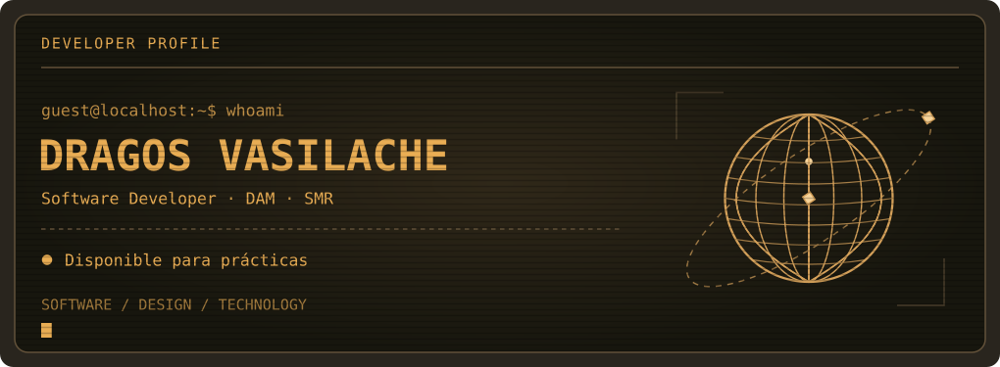
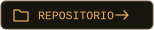
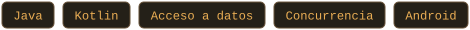
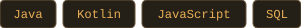
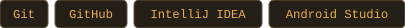

## Sobre mí

Estudiante de **2.º de Desarrollo de Aplicaciones Multiplataforma (DAM)** y técnico en **Sistemas Microinformáticos y Redes (SMR)**. Me interesa desarrollar software claro, mantenible y bien diseñado, combinando programación, UX/UI y automatización. Actualmente estoy profundizando en Java, Android e inteligencia artificial aplicada, incluidos los sistemas basados en agentes.

## Proyectos destacados

<table width="100%">
<tr>
<td width="72" align="center" valign="middle"></td>
<td valign="top">
<h3><a href="https://github.com/Pato-al-aparato/flight-simulator-2d">Simulador espacial 2D — TFG</a></h3>
EN DESARROLLO · PROYECTO FINAL DE DAM

Proyecto de simulación espacial en 2D con Java y JavaFX, orientado a combinar un modelo físico simplificado, control manual y automático e instrumentación visual de vuelo.

</td>
</tr>
</table>

<table width="100%">
<tr>
<td width="72" align="center" valign="middle"></td>
<td valign="top">
<h3><a href="https://github.com/Pato-al-aparato/portfolio">Portfolio personal</a></h3>
EN DESARROLLO · PROYECTO PERSONAL

Portfolio web diseñado desde cero para presentar mis proyectos y conocimientos mediante una identidad visual propia, una interfaz cuidada y especial atención al diseño UX/UI.

</td>
</tr>
</table>

<table width="100%">
<tr>
<td width="72" align="center" valign="middle"></td>
<td valign="top">
<h3><a href="https://github.com/Pato-al-aparato/2dam-repo">2.º DAM — Repositorio académico</a></h3>
ACTIVO · FORMACIÓN ACADÉMICA

Repositorio académico de ejercicios, prácticas y proyectos de 2.º de DAM, organizado por módulos y temas como registro de aprendizaje y evolución técnica.

</td>
</tr>
</table>

## Tecnologías y herramientas

**Lenguajes**

**Tecnologías**

**Herramientas**

## Actualmente

Desarrollando el **[simulador espacial 2D](https://github.com/Pato-al-aparato/flight-simulator-2d)** como proyecto final de DAM y refinando mi **[portfolio personal](https://github.com/Pato-al-aparato/portfolio)**. También continúo profundizando en Android, acceso a datos y automatización aplicada al desarrollo.
